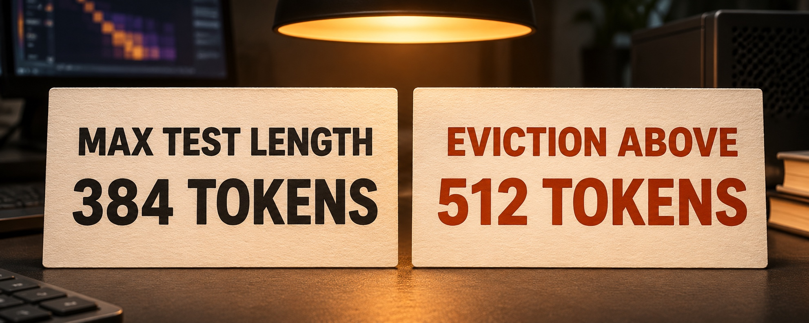

[简体中文](README.md) · [English](README.en.md)

# Assumption Audit

[Install and use](#install-and-use) · [21 blind-test prompts](references/blind-tests.en.md) · [MIT license](LICENSE)

## 576 GPU hours later, you discover the experiment was flawed from the start


*The bill and the reactions are fictional, and the images are generated illustrations. The excerpts below are English translations from a real comparison on the same prompt.*

You ask AI to design an experiment to transfer math gains between two models. Their architectures match, and the weights fit. The models were trained independently, so two components with the same index may do different jobs. The run finishes with a lower score, and you still do not know whether the math gains can transfer.

- **Default response.** “If match quality is very low, the preregistered experiment can still run. Interpret the results as the success or failure of that matching and transplant method.”
- **With Assumption Audit.** “Resume the main experiment only after the revised plan passes validation on held-out inputs.”

### “I used a standard function. How did I end up testing a different method?”


The paper computes its matrix from the raw data. The code uses `np.cov`, which subtracts the mean first. **The same data can produce different directions.** Both responses restored the paper's formula. The response with the skill also put a check in the final plan. Run both versions on **the same input**, compare the directions they select, and pause the formal comparison if they disagree.

### “The preflight passed. It never ran the step we meant to test.”



The cache only starts evicting old entries above **512**. The longest test run reached **384**. Both responses caught that the test never triggered eviction. The response with the skill specified **what to check once entries are actually removed**. Keep the same entries in the reference and physical eviction implementations, then compare their outputs one step at a time. If they disagree, pause the long-context evaluation.

*The comparison used `gpt-6.1-sol`, with one fresh run per prompt in each condition, with and without the skill installed. Personal global `AGENTS.md` rules were isolated. Both conditions identified the core risks on all four prompts. These three examples show differences in the final plans.*

**Assumption Audit** is an MIT-licensed Codex skill. It checks assumptions before Codex hands over an experiment it designed, reviews an existing plan, or gives a recommendation that matters. It proposes a small check that exercises the suspected failure and puts the correction and stop conditions in the plan you will actually use.

> “The plots are done. Now I have to rewrite step one.”


## Install and use

Download or clone this repository. Copy the `assumption-audit/` directory, including `SKILL.md` and `references/`, to one of these locations.

| Scope | Codex directory |
| --- | --- |
| Current project | `<project-root>/.agents/skills/assumption-audit/` |
| All projects for your user account | `~/.agents/skills/assumption-audit/` |

In the Codex CLI or IDE, type `$assumption-audit` to invoke it explicitly. You can also select it from the client's skill picker. Try this in a new session.

```text
$assumption-audit I plan to run this experiment. Give me one sentence I can paste into the experiment plan.
```

After installation, Codex can select the skill when its description matches the task. To make it the default for relevant requests, add the following instruction to the project's `AGENTS.md` or to your global `~/.codex/AGENTS.md`.

```text
When I ask you to design or review an experiment, or propose a method transfer, technical choice, or judgment that could affect a conclusion or action, use $assumption-audit before giving advice, delivering the plan, or carrying it out.
```

[OpenAI's skills guide](https://learn.chatgpt.com/docs/build-skills) · [OpenAI's AGENTS.md guide](https://learn.chatgpt.com/docs/agent-configuration/agents-md)

## Try the blind tests

The [blind-test guide](references/blind-tests.en.md) contains 21 prompts. They cover experiment design from scratch, research replication, product metrics, statistical inference, data leakage, system acceptance tests, everyday costs, strict JSON, and automatic invocation. Some prompts have sound premises and serve as controls. Give a fresh session the prompt and its source material, and keep the scoring notes separate. Check whether the opening flags the issue and its consequence, whether the proposed check exercises the critical operation, and whether the final deliverable applies the correction. The guide records isolated runs and highlights checks that can start with existing data.
