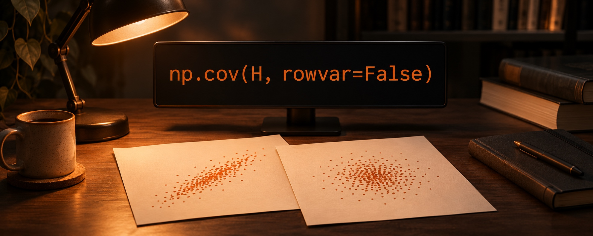
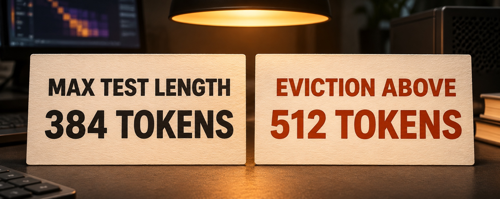

[简体中文](README.md) · [English](README.en.md)

# Assumption Audit · 前提审查

[安装与调用](#安装与调用) · [21 道盲测题](references/blind-tests.md) · [MIT 许可证](LICENSE)

## 实验跑完才发现，结果回答不了一开始的问题

Assumption Audit 是一个 Codex Skill。它在 AI 交付自己设计的实验前检查关键前提，给出一个可以先做的小验证，并把验证不过时该暂停哪一步写进最终方案。它也能审查你写的方案和其他 AI 生成的草稿。

*同题对照中，两组都发现了核心风险。下面展示最终方案在验证步骤和暂停条件上的差异。*

### 模型权重装得进去，部件功能未必对得上


*576 GPU 小时的账单、配图和人物反应均为虚构演示。*

两个模型分开训练，同编号的部件可能承担不同功能。移植后数学题掉分，也可能是部件没对齐。先用留出的样本检查能否对齐，通过后再跑主实验。

- **本次未启用 Skill** 「若匹配质量很低，仍可运行预注册实验，但需将结果解释为该匹配与移植方法的成败。」
- **本次启用 Skill** 「只有新方案重新通过留出验证才能恢复主实验。」

### 复现论文时，库函数的默认行为改了算法



论文直接用原始数据，`np.cov` 却会先减去均值。启用 Skill 的方案要求用同一份数据核对论文公式和代码选出的方向，对不上就暂停正式比较。

### 缓存验收通过了，淘汰逻辑一次都没跑



试跑只到 **384** 个条目，超过 **512** 才会开始淘汰。启用 Skill 的方案要求跑过阈值，让参考实现和实际淘汰实现保留相同条目，再逐步比较输出。对不上就暂停长文本评测。

> 「图都画完了。现在得回去重写第一步。」


## 安装与调用

下载或克隆本仓库，把包含 `SKILL.md` 和 `references/` 的 `assumption-audit/` 目录作为整体复制到目标位置。

| 使用范围 | Codex 目录 |
| --- | --- |
| 当前项目 | `<项目根目录>/.agents/skills/assumption-audit/` |
| 当前用户的所有项目 | `~/.agents/skills/assumption-audit/` |

在 Codex CLI 或 IDE 中输入 `$assumption-audit` 显式调用。也可以在客户端的 Skill 选择器中选中它。新会话里可以这样用。

```text
$assumption-audit 我打算按这个实验方案跑。请给我一句可直接放进实验计划的安排。
```

安装后，Codex 可以根据任务描述选择 Skill。希望它在符合范围的任务中默认使用时，可以把下面这句话加到项目的 `AGENTS.md`，或加到自己的全局 `~/.codex/AGENTS.md`。

```text
当我请你设计或审查实验，或提出会影响结论或行动的方法迁移、技术选型或判断时，在给出建议、交付内容或执行前使用 $assumption-audit。
```

[OpenAI 的 Skill 指南](https://learn.chatgpt.com/docs/build-skills) · [OpenAI 的 AGENTS.md 指南](https://learn.chatgpt.com/docs/agent-configuration/agents-md)

## 看看它是否好用

[盲测指南](references/blind-tests.md)收录 21 道题，覆盖从零设计实验、论文复现、产品指标和统计推断、数据泄漏、系统验收、日常成本、严格 JSON、自动触发和正常对照。把题干和指定材料发给新会话，自己留着评分答案。核对首句提醒、验证是否触发关键操作，以及最终方案是否落实了纠正。指南还记录了隔离运行结果和可优先用现有数据完成的检查。
